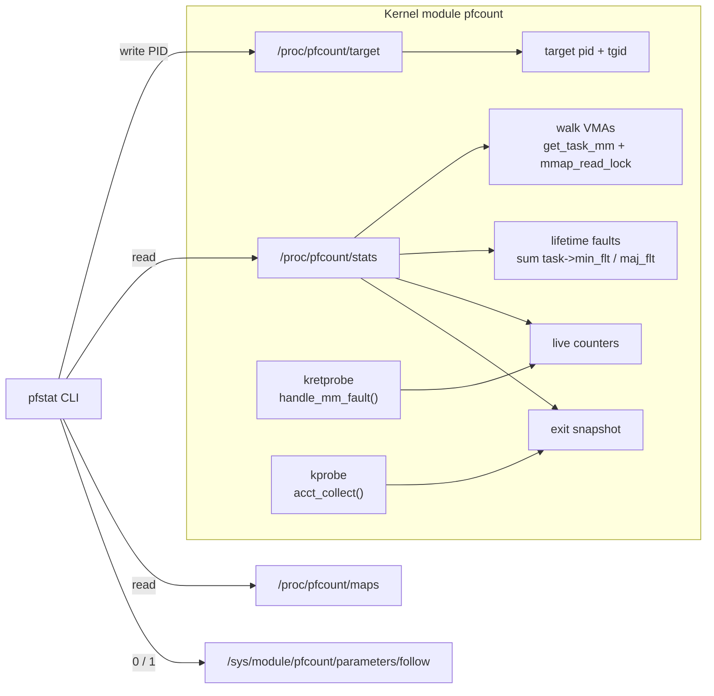

# Mini-Project 2 – Page-Fault Counter for a Process

CPE333 Operating Systems · Topic: Virtual Memory

## 1. Goal

The assignment asks for a tool that takes a process ID and reports:

1. the number of memory regions,
2. the total virtual address space,
3. the number of minor page faults,
4. the number of major page faults.

We built three parts:

| Part | File | Role |
|---|---|---|
| Kernel module `pfcount` | `module/pfcount.c` | Reads the VMAs and fault counters inside the kernel and counts faults live. |
| CLI `pfstat` | `tools/pfstat` | Selects the target, prints the report, and checks each number against an independent source. |
| Test program `faultgen` | `tests/faultgen.c` | Causes a known number of faults of a known type, so we can check the counts. |

Every number the tool prints is checked against a second source: `/proc/<pid>/maps`, `/proc/<pid>/status`, `/proc/<pid>/stat`, or `getrusage()`. All checks in section 6 match, with one documented exception that has a fix.

## 2. Background

**Virtual memory areas (VMAs).** The kernel describes a process's address space with one `struct mm_struct`. That struct holds a set of `struct vm_area_struct` objects (VMAs). Each VMA is one contiguous range `[vm_start, vm_end)` with one set of permissions and one backing: a file, anonymous memory, the heap, the stack, or a special kernel mapping like `[vdso]`. Since Linux 6.1 the VMAs are stored in a maple tree, and code walks them with `VMA_ITERATOR` and `for_each_vma`. Each line of `/proc/<pid>/maps` is one VMA.

**Page faults.** A VMA only reserves address space. A physical page is attached on the first access, when the CPU raises a page fault and the kernel runs `handle_mm_fault()`.

- A **minor fault** is solved without I/O. The page is a new zero-filled anonymous page, or it is already in the page cache.
- A **major fault** must wait for I/O, normally a read from disk.

The kernel counts both per thread in `task->min_flt` and `task->maj_flt`. `mm_account_fault()` in `mm/memory.c` updates them with this rule:

```c
if (ret & VM_FAULT_RETRY)  return;          // will be retried, count it later
if (ret & VM_FAULT_ERROR)  return;          // SIGSEGV / SIGBUS, not counted
major = (ret & VM_FAULT_MAJOR) || (flags & FAULT_FLAG_TRIED);
```

## 3. Environment

| Item | Value |
|---|---|
| Host | MacBook, Apple M2, macOS 15.7.4 |
| VM | Lima 2.2.1, Apple Virtualization.framework (`vz`), 4 vCPU, 4 GiB |
| Guest | Ubuntu 24.04.5 LTS, kernel `6.8.0-142-generic`, `aarch64` |
| Compiler | gcc 13.3.0 |
| Page size | 4096 bytes |
| THP | `madvise` mode |
| `fault_around_bytes` | 65536 (16 pages) |
| `read_ahead_kb` | 128 |

The full capture is in `results/00-environment.txt`.

## 4. Design



### 4.1 Memory regions and address space

`stats_show()` follows the hint in the instructions:

```c
task = get_pid_task(target_pid, PIDTYPE_PID);
mm = get_task_mm(task);                   // takes a reference on mm
mmap_read_lock_killable(mm);
VMA_ITERATOR(vmi, mm, 0);
for_each_vma(vmi, vma) {
        regions++;
        vsize += vma->vm_end - vma->vm_start;
}
mmap_read_unlock(mm);
mmput(mm);
```

The module also reads `mm->total_vm` as a second check, because that is the source of `VmSize`. It puts each VMA in a group with the same tests `/proc/<pid>/maps` uses:

| Group | Test |
|---|---|
| file | `vma->vm_file != NULL` |
| special | `vma->vm_ops->name()` returns a name (`[vdso]`, `[vvar]`) |
| heap | VMA overlaps `[mm->start_brk, mm->brk]` |
| stack | VMA contains `mm->start_stack` |
| anon | everything else |

`/proc/pfcount/maps` prints the same VMA list as `/proc/<pid>/maps`, with an extra size and group column.

All three `/proc/pfcount` files are root-only (`0600`/`0400`). The module can select any process, so a world-readable file would let a normal user read the layout of a process whose own `/proc/<pid>/maps` they cannot open, for example PID 1.

### 4.2 Fault counts: two sources

**Lifetime counts** show all faults since the process started. The module adds `task->min_flt` and `task->maj_flt` for every live thread and adds `signal->min_flt` and `signal->maj_flt` for threads that already exited. `/proc/<pid>/stat` uses the same sum, so the two must be equal. The sum is read under `signal->stats_lock`, a seqlock, like `do_task_stat()`. When a thread exits, `__exit_signal()` moves its counts into `signal->min_flt` under that lock. A plain RCU walk can see the thread both in the list and in `signal->min_flt`, so it counts it twice, and the next read is lower. `tests/regress.sh lifetime` caught 24 such drops in 20,000 reads without the lock.

**Live counts** show faults from the moment the user selects the target. A kretprobe on `handle_mm_fault()` does the work:

- **Entry handler:** checks `current->tgid` against the target. On a match, it saves the `flags` argument and whether the VMA is file-backed. On no match, it returns 1, so the return handler does not run for other processes.
- **Return handler:** reads the `vm_fault_t` result and applies the same rule as `mm_account_fault()`. It then increments the minor or major counter and the anonymous or file counter.

### 4.3 Short-lived processes: exit snapshot

A program like `python3 -c pass` exits in about 20 ms, before the CLI can read the stats once. A kprobe on `acct_collect()` fixes this. `do_exit()` calls it before `exit_mm()`, so `current->mm` is still valid. Its `group_dead` argument comes from `atomic_dec_and_test(&signal->live)`, so it is true for exactly one thread: the last one to exit. An earlier version probed `do_exit()` and read `signal->live == 1`. That read is racy: when two threads exit at the same time, both can see `live == 0` and no thread takes the snapshot. On the last thread of the target, the probe saves:

- `mm->map_count` – the number of VMAs, kept by the kernel
- `mm->total_vm` – the size at exit
- `max(mm->hiwater_vm, total_vm)` – the peak size (`VmPeak`)

A kprobe handler runs in atomic context and cannot sleep, so it cannot take `mmap_lock`. That is why it reads these counter fields and does not walk the VMAs.

### 4.4 Child processes: follow mode

`getrusage()` for a child that was waited on includes the faults of that child's own children (see finding F7). When the module parameter `follow` is 1, the probe also counts a fault if any ancestor of `current` (through `real_parent`, at most 64 levels) belongs to the target. `pfstat -f` turns this on.

The two sides do not count the same set of processes. The probe counts every descendant. `wait4()` counts only descendants that some process reaped with `wait()`. So in follow mode `pfstat` labels the reference "waited descendants only". A count above it is shown in yellow with a note, not as an error. Only a count below it is an error.

### 4.5 User interface

| Command | Result |
|---|---|
| `sudo pfstat PID` | One-shot report with a check column |
| `sudo pfstat PID --maps` | Adds the VMA list |
| `sudo pfstat PID -w 0.5` | One line every 0.5 s with fault rates |
| `sudo pfstat -- CMD` | Runs CMD, counts its faults live, checks against `getrusage()` |
| `sudo pfstat -f -- CMD` | Same, and also counts CMD's child processes |

In run mode, the parent forks. The child stops itself with `SIGSTOP`, so the parent can select it as the target before `execve()`, and no fault is missed. The parent reads the child's lifetime counters while the child is stopped (the base value). The expected live count is then `getrusage().ru_minflt - base`. The child drops back to the `SUDO_UID` user before `execve()`.

## 5. How to reproduce

### 5.1 On macOS (what we used)

```sh
git clone <repo> && cd <repo>/Y3/CPE333/mini-project-02
./vm.sh setup          # installs Lima if needed, creates the Ubuntu 24.04 VM,
                       # installs build-essential + linux-headers-$(uname -r)
./vm.sh make demo      # builds, loads, runs the demo from section 6.3
./vm.sh make experiments   # runs every experiment, writes results/*.txt
```

### 5.2 On native Ubuntu / Debian

```sh
sudo apt install build-essential linux-headers-$(uname -r) python3
make demo
make experiments
```

### 5.3 By hand

```sh
make load                                  # build + insmod
./tests/faultgen anon:64 wait &            # any process
sudo tools/pfstat $! --maps                # report for that PID
cat /proc/$!/maps | wc -l                  # compare
sudo tools/pfstat -w 0.5 -- tests/faultgen sleep:1 anon:64 sleep:1 free sleep:1
make unload
```

`faultgen` steps:

| Step | Action | Expected effect |
|---|---|---|
| `anon:MB` | `mmap` anonymous, `MADV_NOHUGEPAGE`, write 1 byte per 4 KB page | +1 region, +MB×256 minor |
| `thp:MB` | same with `MADV_HUGEPAGE` | +1 region, about MB/2 minor |
| `file:PATH` | `POSIX_FADV_DONTNEED`, `mmap`, `MADV_RANDOM`, read 1 byte per page | +1 region, 1 major per page |
| `filewarm:PATH` | same, no cache drop | minor only |
| `fileseq:PATH` | cache drop, readahead left on | few major |
| `free` | `munmap` all of the above | regions and size go back |
| `sleep:N`, `wait`, `loop` | timing control | – |

## 6. Experiments and results

`scripts/experiments.sh` produces every number below. The raw output is in `results/`. Each run-mode result was checked against `getrusage()`. With `-f`, `wait4()` is a lower bound (F12), and here it matched exactly.

`faultgen` itself takes a fixed number of faults to start up (exec, ld.so, libc, `printf`): about 65 anonymous and about 75 file-backed. We call this the **baseline** and subtract it below.

### 6.1 E1 – Report against `/proc` (correctness)

| Target | Regions | Address space | `total_vm` vs `VmSize` | Minor | Major | Result |
|---|---|---|---|---|---|---|
| `sleep 300` | 30 | 5.6 MB | 5.6 MB | 104 | 0 | all match |
| PID 1 `systemd` | 113 | 22.1 MB | 22.1 MB | 35,741 | 95 | all match |

The region list for `sleep` (`results/e1a-report-sleep.txt`) has the same 30 lines as `/proc/<pid>/maps`: 24 file (the binary, libc, ld.so, locale files), 2 anon, heap, stack, `[vvar]`, `[vdso]`.

### 6.2 E2–E6 – Controlled faults

| # | Workload (32 MB file = 8,192 pages) | Minor | Major | Anon | File | `getrusage()` |
|---|---|---|---|---|---|---|
| E2 | 64 MB anonymous, 4 KB pages | 16,525 | 1 | 16,450 | 76 | match |
| E3 | file, cold cache, `MADV_RANDOM` | 145 | **8,193** | 71 | 8,267 | match |
| E4 | file, warm cache, `MADV_RANDOM` | 655 | 1 | 70 | 586 | match |
| E5 | file, cold cache, readahead on | 654 | **2** | 66 | 590 | match |
| E6 | 64 MB anonymous, THP | 177 | 1 | 100 | 78 | match |

After the baseline is removed:

| # | Expected | Measured | Explanation |
|---|---|---|---|
| E2 | 16,384 minor | 16,450 − 65 ≈ 16,385 | One fault per 4 KB page. |
| E3 | 8,192 major | 8,193 − 1 = 8,192 | One disk read per page. |
| E4 | 8,192 minor if one per page | 586 − 75 ≈ 511 | Fault-around maps 16 cached pages per fault: 8,192 / 16 = 512. |
| E5 | – | 1 major + about 515 minor | Readahead loads the file after the first major fault. |
| E6 | 64 MB / 2 MB = 32 | 100 − 65 ≈ 35 | One fault per 2 MB huge page. |

### 6.3 E7 – Timeline (watch mode)

`faultgen sleep:1 anon:64 sleep:1 file:<32MB> sleep:1 free sleep:1`, one sample every 0.5 s:

```
 time  regions    vsize      rss   minflt  majflt   min/s  maj/s
  0.0       51  20.0 MB   9.5 MB      520       0       0      0   <- before execve (F6)
  0.5       16   2.2 MB   1.4 MB      570       1      99      2
  1.0       17  66.2 MB   7.9 MB    2,219       1    3257      0   <- anon mmap: +1 region, +64 MB, touching
  1.5       17  66.2 MB  65.4 MB   16,954       1   29198      0   <- all pages touched: RSS follows
  2.5       18  98.2 MB  97.2 MB   16,954   8,193       0  16212   <- file: +1 region, +8,192 major
  3.5       16   2.2 MB   1.3 MB   16,954   8,193       0      0   <- free: regions and size drop
Regions at exit 16 · size at exit 2.2 MB · peak 98.2 MB · faults match getrusage()
```

Address space (`vsize`) grows at `mmap` time. Resident memory (`rss`) grows only when pages are touched. This is demand paging, shown in two columns.

### 6.4 E8 – Real programs

| Command | Regions at exit | Size at exit | Minor | Major | Check |
|---|---|---|---|---|---|
| `python3 -c pass` | 35 | 17.2 MB | 1,231 | 0 | match |
| `sh -c 'ls -R /usr/include'` | 17 | 2.3 MB | 245 | 0 | **differs by −134** |
| same with `-f` | 17 | 2.3 MB | 397 | 0 | match |
| `gcc -O2 faultgen.c` | 21 | 6.6 MB | 304 | 0 | **differs by −5,713** |
| same with `-f` | 21 | 6.6 MB | 6,001 | 0 | match |

The `gcc` driver itself takes only about 5 % of the faults. The other 95 % happen in `cc1`, `as`, `collect2`, and `ld`.

## 7. Journey and findings

The list is in the order we found things.

**F1 – macOS cannot load a Linux module.** We first tried OrbStack, which was already installed. Its Linux machines share one custom kernel with no `linux-headers` package, so out-of-tree modules cannot build. We changed to Lima with the stock Ubuntu cloud image. It runs the real `-generic` kernel, and `apt` has headers for it. `vm.sh` puts this in one command.

**F2 – The apt lock at first boot.** `apt-get install` failed with `Could not get lock /var/lib/apt/lists/lock` because cloud-init was still updating. Fix: `-o DPkg::Lock::Timeout=600`.

**F3 – The hinted tracepoint is not usable here.** `exceptions:page_fault_user` (from `include/trace/events/exceptions.h`) is defined only by x86 code (`arch/x86/mm/fault.c`). Our VM is arm64. That tracepoint also fires *before* the fault is handled, so it does not know minor from major. A kretprobe on `handle_mm_fault()` works on every architecture and sees the result, so we used it. We copied the counting rule from `mm_account_fault()` and confirmed it: E2–E8 match `getrusage()` exactly.

**F4 – Path case.** The repo path on macOS is `Y3/`, but a shell had `cd`'d into `y3/`. APFS ignores case, so this works on the Mac. The VM mount is case-sensitive, so `limactl shell --workdir` failed. `pwd -P` in `/bin/sh` keeps the typed case, but `realpath` returns the on-disk case. `vm.sh` now uses `realpath`.

**F5 – Short programs exit before the first sample.** The first version sampled the stats while the child ran. For a 20 ms program it got "0 regions". The fix was the exit kprobe (section 4.3). Now every run reports regions, size at exit, and peak size, for example the 98.2 MB peak in E7.

**F6 – Fork before exec.** The first watch-mode sample in E7 shows 51 regions and 20 MB. That is not `faultgen`. It is the copy of the Python `pfstat` process that `fork()` made, before `execve()` replaced the address space with a new `mm_struct`. An earlier version used this sample as the "peak" by mistake. We dropped sampled peaks and use `hiwater_vm` from the exit snapshot.

**F7 – `getrusage()` includes child processes.** `ls` and `gcc` did not match (E8). `wait4()` returns usage for the child *plus all descendants it waited for*, because the kernel adds `cmin_flt` up the tree at reap time. Our probe counted one thread group only. We added follow mode (section 4.4). With `-f`, both match. Without `-f`, `pfstat` prints a hint.

**F8 – `MADV_RANDOM` turns off readahead, not fault-around.** We expected E4 (warm cache, `MADV_RANDOM`) to show one minor fault per page, 8,192. It showed about 511. `should_fault_around()` in 6.8 does not check `VM_RAND_READ`. On a page-cache hit, `do_read_fault()` maps up to `fault_around_bytes` = 64 KB = 16 neighbor pages that are already cached, and 8,192 / 16 = 512. In E3 the cache was cold, so there were no neighbors to map, and every page was a major fault.

**F9 – Readahead turns 8,192 major faults into 1.** E5 is E3 without `MADV_RANDOM`. The first fault starts synchronous readahead. After that, asynchronous readahead stays ahead of the reader, so every later fault finds the page in the cache and is minor (with fault-around, again about 512 of them).

**F10 – Huge pages.** 64 MB with THP took about 38 faults instead of 16,384 (E6). Each fault maps a 2 MB page. Recent kernels also align large anonymous mappings to a 2 MB boundary, so the whole region can use huge pages.

**F11 – Small checks.**

- `total_vm` always equals the VMA sum.
- `[vsyscall]` appears in `/proc/<pid>/maps` on x86 but is not a VMA in the maple tree. `pfstat` skips it when it compares. arm64 has no `[vsyscall]`, so we did not test this case.
- `kretprobe.nmissed` stayed 0 in all runs, with `maxactive = 64`.
- Loading the module logs "module verification failed … tainting kernel". This is normal for an unsigned out-of-tree module.

**F12 – `wait4()` is not a full reference for follow mode.** A reviewer found a case where `-f` reported more faults than `wait4()`: a Python parent sets `SIGCHLD` to `SIG_IGN` and forks a child that touches 16 MB. The kernel reaps that child automatically, and `wait_task_zombie()` never adds its counts to the parent's `cmin_flt`. We reproduced it: pfcount 6,579 minor faults, `wait4()` 2,080 (+4,499, about 16 MB / 4 KB). The probe was right. The reference was missing the auto-reaped child. `pfstat -f` now names the reference "waited descendants only" and explains a positive difference.

## 8. Limitations

- Live counts start when the target is selected. Use run mode (`pfstat -- CMD`) to see a program's full life.
- Follow mode tracks descendants through `real_parent`. A grandchild whose parent exits first is reparented to init (or a subreaper) and is no longer counted. `getrusage()` also loses it.
- In follow mode, `wait4()` is only a lower bound. Children that are auto-reaped (`SIGCHLD` ignored or `SA_NOCLDWAIT`) are counted by the probe but not by `wait4()` (F12). We have no independent reference with the same scope.
- The kretprobe runs for every page fault on the system and returns early for other processes. We did not measure this overhead.
- The exit snapshot uses counter fields without `mmap_lock`. That is safe for the last thread at exit, but it gives no per-VMA detail.
- PIDs are resolved in the writer's PID namespace. We tested only in the initial namespace.
- We tested only on 6.8 arm64. `VMA_ITERATOR` needs 6.1 or later. `regs_get_kernel_argument()` exists on x86_64 and arm64.

## 9. Conclusion

The tool reports all four required values for any PID. Each value matches an independent kernel interface:

| Value | Source in kernel | Checked against |
|---|---|---|
| Memory regions | `for_each_vma` count (and `mm->map_count`) | `/proc/<pid>/maps` line count |
| Address space | sum of `vm_end - vm_start` | `/proc/<pid>/maps` sum, `VmSize` |
| Minor faults | `task->min_flt` sum, kretprobe on `handle_mm_fault` | `/proc/<pid>/stat` field 10, `getrusage()` |
| Major faults | `task->maj_flt` sum, kretprobe on `handle_mm_fault` | `/proc/<pid>/stat` field 12, `getrusage()` |

The experiments also show how page-cache state, readahead, fault-around, and huge pages change fault counts for the same work by more than 10×. For example, reading the same 32 MB file took 8,192 major faults with a cold cache and `MADV_RANDOM` (E3), but only 1 major fault with readahead on (E5).

## Appendix A – Files

| Path | Lines | Content |
|---|---|---|
| `module/pfcount.c` | 533 | Kernel module |
| `module/Makefile` | – | kbuild |
| `tools/pfstat` | 292 | CLI (Python 3, standard library only) |
| `tests/faultgen.c` | 160 | Fault generator |
| `scripts/experiments.sh` | – | Runs E1–E8 |
| `results/*.txt` | – | Raw output of the last run |
| `Makefile` | – | `all load unload reload demo experiments clean` |
| `vm.sh` | – | `setup shell make run stop delete` for macOS |

## Appendix B – References

- Linux source: `mm/memory.c` (`handle_mm_fault`, `mm_account_fault`, `do_read_fault`, `should_fault_around`), `fs/proc/task_mmu.c` (`/proc/<pid>/maps`), `fs/proc/array.c` (`/proc/<pid>/stat`), `kernel/exit.c` (`do_exit`), `kernel/acct.c` (`acct_collect`).
- [Process Addresses – kernel docs](https://docs.kernel.org/mm/process_addrs.html)
- [Tracepoints – kernel docs](https://docs.kernel.org/trace/tracepoints.html)
- [Kernel Probes (Kprobes) – kernel docs](https://docs.kernel.org/trace/kprobes.html)
- [`include/trace/events/exceptions.h`](https://github.com/torvalds/linux/blob/master/include/trace/events/exceptions.h)
- `madvise(2)`, `posix_fadvise(2)`, `getrusage(2)`, `proc(5)` man pages
